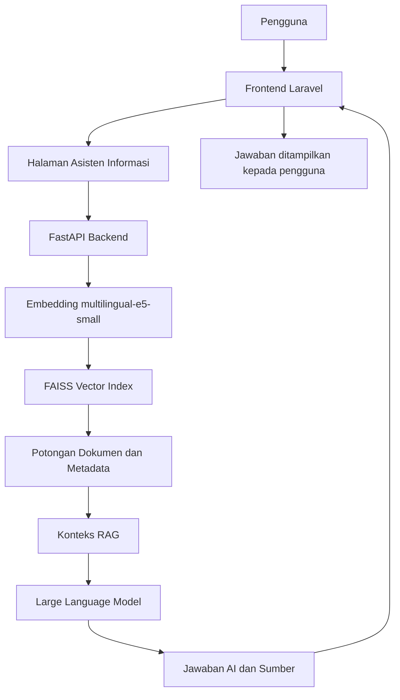
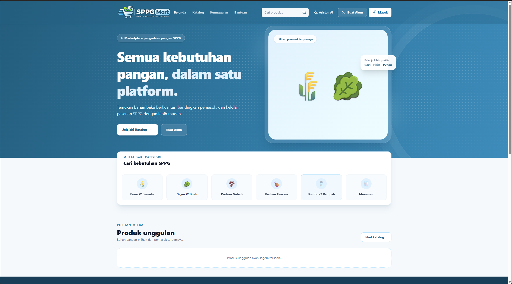
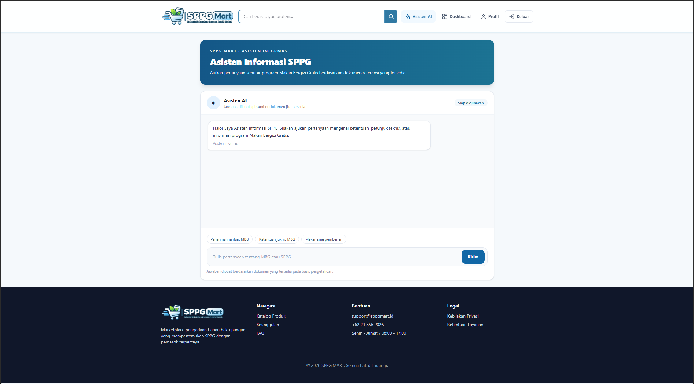

# SPPG Mart

**SPPG Mart** adalah aplikasi web yang dirancang untuk mendukung
ekosistem Satuan Pelayanan Pemenuhan Gizi (SPPG) melalui antarmuka
marketplace pengadaan bahan pangan dan fitur Asisten Informasi berbasis
kecerdasan buatan.

Fitur Asisten Informasi memanfaatkan pendekatan **Retrieval-Augmented
Generation (RAG)** agar pengguna dapat mengajukan pertanyaan mengenai
Program Makan Bergizi Gratis (MBG) dan memperoleh jawaban berdasarkan
dokumen referensi yang tersedia, disertai informasi sumber dokumen.

> **Status proyek:** Mini-project / prototype hasil pengembangan. Fitur
> dan konfigurasi yang dapat dijalankan bergantung pada source code,
> file konfigurasi, serta knowledge base yang disertakan pada
> repository.

---

## Daftar Isi

- [Latar Belakang](#latar-belakang)
- [Fitur Utama](#fitur-utama)
- [Arsitektur Sistem](#arsitektur-sistem)
- [Teknologi yang Digunakan](#teknologi-yang-digunakan)
- [Sumber Knowledge Base](#sumber-knowledge-base)
- [Struktur Repository](#struktur-repository)
- [Persyaratan Sistem](#persyaratan-sistem)
- [Instalasi dan Menjalankan
  Aplikasi](#instalasi-dan-menjalankan-aplikasi)
    - [1. Clone Repository](#1-clone-repository)
    - [2. Menyiapkan Backend AI
      FastAPI](#2-menyiapkan-backend-ai-fastapi)
    - [3. Menyiapkan Frontend Laravel](#3-menyiapkan-frontend-laravel)
    - [4. Menjalankan Aplikasi](#4-menjalankan-aplikasi)
- [Pengujian API](#pengujian-api)
- [Alur Kerja Asisten Informasi](#alur-kerja-asisten-informasi)
- [Batasan Sistem](#batasan-sistem)
- [Keamanan dan Konfigurasi](#keamanan-dan-konfigurasi)
- [Dokumentasi Tampilan](#dokumentasi-tampilan)
- [Pengembang](#pengembang)

---

## Latar Belakang

Pengelolaan informasi dalam pelaksanaan Program Makan Bergizi Gratis
(MBG) melibatkan berbagai ketentuan, petunjuk teknis, dan dokumen
pendukung. Informasi yang tersebar dalam dokumen dapat membutuhkan waktu
untuk ditelusuri, terutama ketika pengguna hanya memerlukan jawaban atas
pertanyaan tertentu.

SPPG Mart dikembangkan sebagai aplikasi web dengan konsep marketplace
pengadaan bahan pangan untuk mendukung kebutuhan ekosistem SPPG. Selain
antarmuka marketplace, aplikasi ini dilengkapi **Asisten Informasi
SPPG** yang memungkinkan pengguna menyampaikan pertanyaan menggunakan
bahasa alami.

Asisten Informasi menggunakan Large Language Model (LLM) yang dipadukan
dengan Retrieval-Augmented Generation (RAG). Pendekatan ini
menggabungkan pencarian potongan informasi dari knowledge base dengan
proses penyusunan jawaban oleh model. Dengan demikian, respons diarahkan
agar merujuk pada dokumen yang tersedia, bukan hanya mengandalkan
pengetahuan internal model.

## Fitur Utama

### 1. Marketplace SPPG Mart

- Antarmuka marketplace untuk mendukung pencarian kebutuhan bahan
  pangan.
- Kolom pencarian produk, seperti beras, sayur, dan protein.
- Halaman navigasi aplikasi, termasuk akses ke dashboard dan profil
  pengguna.
- Antarmuka dirancang sebagai bagian dari sistem SPPG Mart.

### 2. Asisten Informasi SPPG

- Pengguna dapat mengajukan pertanyaan mengenai ketentuan dan
  informasi Program MBG.
- Pertanyaan diproses melalui backend AI menggunakan FastAPI.
- Sistem melakukan pencarian informasi pada knowledge base menggunakan
  FAISS.
- Potongan dokumen yang relevan digunakan sebagai konteks bagi LLM.
- Respons dapat dilengkapi informasi sumber dokumen dan nomor halaman
  berdasarkan metadata retrieval.
- Sistem dirancang untuk menyatakan keterbatasan apabila informasi
  yang ditanyakan tidak ditemukan pada sumber yang tersedia.

### 3. Backend API

- Endpoint pemeriksaan kesiapan layanan melalui `GET /health`.
- Endpoint percakapan melalui `POST /chat`.
- Respons API memuat jawaban dan informasi sumber sesuai implementasi
  backend.

---

## Arsitektur Sistem

SPPG Mart menggunakan pemisahan antara aplikasi web dan layanan AI.
Laravel berperan sebagai frontend aplikasi, sedangkan FastAPI menangani
proses asisten informasi dan integrasi retrieval dengan model bahasa.



### Alur singkat pemrosesan pertanyaan

1.  Pengguna mengirim pertanyaan melalui halaman Asisten Informasi.
2.  Frontend Laravel meneruskan permintaan ke backend FastAPI.
3.  Backend mengubah pertanyaan menjadi representasi embedding.
4.  FAISS mencari potongan dokumen yang memiliki kemiripan semantik
    dengan pertanyaan.
5.  Potongan dokumen terpilih disusun menjadi konteks.
6.  LLM menghasilkan jawaban berdasarkan pertanyaan dan konteks yang
    diberikan.
7.  Backend mengembalikan jawaban beserta metadata sumber.
8.  Laravel menampilkan respons kepada pengguna.

---

## Teknologi yang Digunakan

---

Komponen Teknologi Peran

---

Frontend aplikasi Laravel Menyediakan antarmuka
web SPPG Mart

Backend AI Python dan FastAPI Menyediakan layanan API
Asisten Informasi

Model bahasa LLM melalui API Menyusun jawaban
berdasarkan konteks

Model embedding `multilingual-e5-small` Mengubah teks menjadi
vektor embedding

Vector index FAISS Melakukan pencarian
kemiripan vektor

Pendekatan AI Retrieval-Augmented Menghubungkan retrieval
Generation (RAG) dokumen dengan generasi
jawaban

Format metadata JSON Menyimpan informasi
dokumen dan potongan
teks

---

> Nama model bahasa, versi library, dan konfigurasi teknis yang
> digunakan saat menjalankan aplikasi mengikuti file konfigurasi aktual
> pada source code. Periksa `requirements.txt`, `composer.json`, dan
> file environment untuk detail versinya.

## Sumber Knowledge Base

Knowledge base awal Asisten Informasi disusun dari dokumen referensi
yang berkaitan dengan Program MBG, yaitu:

1.  **Petunjuk Teknis Tata Kelola Penyelenggaraan Program Makan Bergizi
    Gratis Tahun Anggaran 2026.**
2.  **Peraturan Presiden Nomor 115 Tahun 2025 tentang Tata Kelola
    Penyelenggaraan Program Makan Bergizi Gratis.**
3.  **Peraturan Badan Gizi Nasional Nomor 5 Tahun 2026.**

Dokumen diproses sebelum digunakan oleh sistem. Tahapan yang diterapkan
meliputi ekstraksi teks PDF, normalisasi teks, pemotongan teks menjadi
chunk, penyimpanan metadata dokumen dan halaman, pembentukan embedding,
serta pembuatan indeks FAISS.

Knowledge base yang digunakan pada pengujian terdiri atas **317 chunk**,
dengan rincian berikut:

Dokumen Jumlah chunk

---

Petunjuk Teknis MBG 2026 239
Peraturan BGN Nomor 5 Tahun 2026 17
Perpres Nomor 115 Tahun 2025 61
**Total** **317**

Jumlah tersebut menggambarkan dataset yang digunakan pada tahap
implementasi dan pengujian yang didokumentasikan. Perubahan dokumen atau
preprocessing dapat menghasilkan jumlah chunk yang berbeda.

---

## Struktur Repository

Struktur berikut merupakan gambaran pemisahan komponen frontend dan
backend. Sesuaikan nama folder dengan struktur source code yang
benar-benar diunggah.

```text
sppg-mart/
├── frontend/                  # Aplikasi web Laravel
│   ├── app/
│   ├── resources/
│   ├── routes/
│   ├── public/
│   ├── composer.json
│   └── package.json
│
├── backend-ai/                # Layanan Asisten Informasi
│   ├── main.py
│   ├── requirements.txt
│   ├── index.faiss
│   ├── metadata.json
│   └── ...
│
├── docs/
│   └── screenshots/          # Dokumentasi tampilan aplikasi
│
├── .gitignore
└── README.md
```

File indeks, metadata, dan dokumen sumber hanya perlu disertakan apabila
memang digunakan saat aplikasi dijalankan dan distribusinya diizinkan.
Jangan mengunggah file rahasia atau data internal.

---

## Persyaratan Sistem

Sebelum menjalankan aplikasi, siapkan:

- Git.
- PHP dan Composer sesuai versi yang didukung proyek Laravel.
- Node.js dan npm.
- Python sesuai versi yang digunakan backend.
- API key dari penyedia LLM yang digunakan proyek.
- File konfigurasi environment untuk frontend dan backend.
- File knowledge base dan indeks FAISS apabila tidak dibuat otomatis
  saat aplikasi dijalankan.

Versi pasti setiap dependensi dapat diperiksa pada `composer.json`,
`composer.lock`, `package.json`, dan `requirements.txt`.

---

## Instalasi dan Menjalankan Aplikasi

Langkah berikut merupakan panduan umum. Nama direktori, nama variabel
environment, dan konfigurasi koneksi API perlu disesuaikan dengan source
code repository.

### 1. Clone Repository

```bash
git clone https://github.com/USERNAME/sppg-mart.git
cd sppg-mart
```

Ganti `USERNAME` dengan nama akun GitHub pemilik repository.

### 2. Menyiapkan Backend AI FastAPI

Masuk ke direktori backend:

```bash
cd backend-ai
```

Buat virtual environment:

**Windows PowerShell**

```powershell
python -m venv .venv
.venv\Scripts\Activate.ps1
```

**Linux atau macOS**

```bash
python3 -m venv .venv
source .venv/bin/activate
```

Instal dependensi:

```bash
pip install -r requirements.txt
```

Siapkan file environment berdasarkan konfigurasi proyek. Jika tersedia
file `.env.example`, salin menjadi `.env`.

**Windows PowerShell**

```powershell
Copy-Item .env.example .env
```

**Linux atau macOS**

```bash
cp .env.example .env
```

Isi API key dan konfigurasi lain pada file `.env` lokal. Jangan
memasukkan API key ke repository.

Pastikan file indeks FAISS dan metadata berada di lokasi yang dibaca
oleh backend. Nama file pada implementasi ini adalah `index.faiss` dan
`metadata.json`, tetapi lokasi pastinya mengikuti konfigurasi kode.

Jalankan backend:

```bash
uvicorn main:app --reload --host 127.0.0.1 --port 8001
```

Jika objek aplikasi atau nama file utama berbeda, sesuaikan perintah
tersebut.

Dokumentasi API dapat diakses melalui:

```text
http://127.0.0.1:8001/docs
```

### 3. Menyiapkan Frontend Laravel

Buka terminal baru, kemudian masuk ke direktori frontend:

```bash
cd frontend
```

Instal dependensi PHP:

```bash
composer install
```

Siapkan file environment:

**Windows PowerShell**

```powershell
Copy-Item .env.example .env
```

**Linux atau macOS**

```bash
cp .env.example .env
```

Buat application key:

```bash
php artisan key:generate
```

Atur koneksi database sesuai konfigurasi aplikasi, kemudian jalankan
migrasi apabila database proyek menggunakan migrasi Laravel:

```bash
php artisan migrate
```

Instal dependensi frontend:

```bash
npm install
```

Bangun asset frontend:

```bash
npm run build
```

Pastikan konfigurasi URL backend AI pada Laravel mengarah ke layanan
FastAPI yang sedang berjalan. Pada konfigurasi lokal contoh ini, backend
berjalan di `http://127.0.0.1:8001`. Gunakan nama environment variable
yang benar sesuai source code proyek.

### 4. Menjalankan Aplikasi

Jalankan Laravel:

```bash
php artisan serve
```

Jika port default telah digunakan, tentukan port lain:

```bash
php artisan serve --port=8000
```

Pastikan FastAPI tetap aktif pada terminal terpisah.

Buka alamat aplikasi Laravel yang muncul pada terminal. Masuk ke halaman
Asisten AI untuk mencoba fitur percakapan.

---

## Pengujian API

### Pemeriksaan status backend

Endpoint:

```http
GET /health
```

Endpoint ini digunakan untuk memeriksa status layanan dan kesiapan
knowledge base.

Contoh pengujian menggunakan curl:

```bash
curl http://127.0.0.1:8001/health
```

### Mengirim pertanyaan kepada Asisten Informasi

Endpoint:

```http
POST /chat
```

Contoh request body berdasarkan skema API yang digunakan pada pengujian:

```json
{
    "question": "Apa saja ketentuan dalam petunjuk teknis MBG?",
    "history": []
}
```

Contoh menggunakan curl:

```bash
curl -X POST "http://127.0.0.1:8001/chat" \
  -H "Content-Type: application/json" \
  -d "{\"question\":\"Apa saja ketentuan dalam petunjuk teknis MBG?\",\"history\":[]}"
```

Respons aktual mengikuti struktur JSON yang dikembalikan backend, yang
mencakup jawaban dan informasi sumber apabila tersedia.

---

## Alur Kerja Asisten Informasi

Tahapan pengolahan dokumen yang digunakan untuk membangun knowledge
base:

1.  **Pengumpulan dokumen:** mengumpulkan dokumen resmi yang menjadi
    sumber informasi MBG.
2.  **Ekstraksi teks:** mengambil teks dari dokumen PDF.
3.  **Normalisasi:** membersihkan karakter dan merapikan whitespace.
4.  **Chunking:** membagi teks menjadi potongan yang lebih kecil agar
    dapat dicari secara semantik.
5.  **Penyimpanan metadata:** menghubungkan setiap chunk dengan
    identitas dokumen dan nomor halaman.
6.  **Embedding:** mengubah setiap chunk menjadi vektor menggunakan
    `multilingual-e5-small`.
7.  **Indexing:** menyimpan vektor ke dalam indeks FAISS.
8.  **Retrieval:** mencari chunk yang relevan ketika pengguna mengajukan
    pertanyaan.
9.  **Generation:** memberikan konteks hasil retrieval kepada LLM untuk
    menyusun jawaban.

---

## Batasan Sistem

- Jawaban Asisten Informasi bergantung pada isi dan cakupan dokumen
  yang tersedia di knowledge base.
- Informasi operasional khusus suatu SPPG, seperti jadwal lokal,
  jumlah penerima manfaat aktual, dan stok bahan pangan, tidak dapat
  dipastikan apabila tidak tersedia pada sumber yang diindeks.
- Relevansi hasil retrieval dapat bervariasi bergantung pada rumusan
  pertanyaan dan isi dokumen.
- Skor similarity pada retrieval menunjukkan tingkat kemiripan vektor,
  bukan persentase akurasi jawaban.
- Jawaban yang dihasilkan LLM tetap perlu diperiksa terhadap dokumen
  sumber, terutama untuk informasi yang bersifat spesifik atau
  membutuhkan ketepatan regulasi.
- Proyek ini merupakan prototype dan tidak dimaksudkan sebagai
  pengganti dokumen resmi atau keputusan pihak berwenang.

---

## Keamanan dan Konfigurasi

Sebelum repository dipublikasikan, pastikan hal-hal berikut:

- Jangan mengunggah `.env` atau file yang berisi API key, password,
  token, dan kredensial database.
- Jangan mengunggah database produksi, data pribadi, atau informasi
  internal yang tidak boleh dipublikasikan.
- Gunakan `.env.example` untuk mendokumentasikan nama variabel
  konfigurasi tanpa mengisi nilai rahasia.
- Pastikan dokumen sumber, gambar, dan aset yang disertakan boleh
  didistribusikan.
- Periksa `.gitignore` agar folder `vendor`, `node_modules`, `.venv`,
  `__pycache__`, file cache, dan file sementara tidak ikut diunggah.

---

## Dokumentasi Tampilan

Simpan screenshot aplikasi pada direktori `docs/screenshots/`, kemudian
tampilkan dengan Markdown. Contoh:

```markdown



```

Ganti nama file dengan screenshot yang benar-benar tersedia di
repository.

---

## Pengembang

**Muhammad Haikhal Al Hakim**

Mahasiswa D4 Manajemen Informatika, Universitas Negeri Surabaya.

Mini-project ini dikembangkan sebagai implementasi pembelajaran dan
penerapan teknologi web serta Generative AI, khususnya Large Language
Model dan Retrieval-Augmented Generation, pada konteks pengelolaan
informasi Program Makan Bergizi Gratis.

---

## Catatan

SPPG Mart merupakan proyek pengembangan perangkat lunak. Informasi yang
disajikan oleh Asisten Informasi bersumber dari dokumen yang tersedia
pada knowledge base. Untuk keputusan resmi, pengguna tetap perlu merujuk
pada dokumen dan ketentuan yang diterbitkan oleh instansi berwenang.
